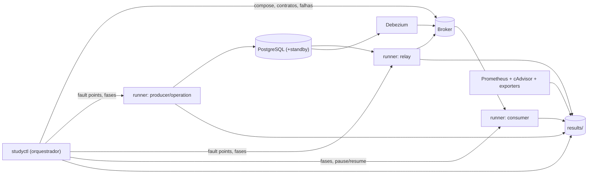

# 06 — Arquitetura do harness

> **Pré-requisito:** a decisão entre estender o OpenMessaging Benchmark e construir instrumento
> próprio é tomada na F0 (doc 11 §6). Este documento especifica **o que o instrumento precisa
> fazer**; se a decisão for estender o OMB, ele descreve as extensões.

## 1. Componentes



## 2. Stack

Java 21 (harness), Gradle com wrapper e lock, picocli, Jackson YAML, HdrHistogram, RoaringBitmap,
Testcontainers; Python 3.12 + uv (orquestração, análise, modelo). Sem framework no caminho quente.
Modelo formal em TLA+ (ou Alloy) em `spec/`.

## 3. Layout

```
event-publishing-study/
├── docs/                      # planejamento, artigo, guia
│   └── relacionados/          # matriz e fichas da revisão (doc 11)
├── spec/                      # modelo formal + histórias mínimas geradas
├── bench-core/                # envelope, SPI, gerador, métricas, fault points
├── bench-verifier/            # conjuntos, multiplicidade por grupo, ordem, categorias
├── bench-adapters/            # noop, inmemory, chaos, kafka, rabbitmq, redis, nats, pulsar, pg-queue
├── bench-patterns/            # operação de negócio, dual-write, outbox, relays (lease/fencing), CDC
├── bench-runner/              # papéis, API de controle, imagem
├── infra/                     # versions.env, compose, configs, postgres, debezium, faults, observability
├── scenarios/                 # _defaults.yaml, _workloads.yaml, N*.yaml, G*.yaml
├── orchestrator/              # studyctl
├── analysis/                  # ingest…classify, mst, cost, model, predictions/, figures, guide/, article/
└── results/                   # fora do git
```

## 4. Envelope

| Offset | Bytes | Campo |
|---|---|---|
| 0 | 1 | `version` |
| 1 | 1 | `flags` (bit 0: amostrado para trace) |
| 2 | 16 | `eventId` (UUIDv7) |
| 18 | 4 | `producerId` |
| 22 | 8 | `producerSeq` |
| 30 | 16 | `aggregateId` (UUID) |
| 46 | 8 | `aggregateVersion` — **ordem canônica** (doc 12 §5.1) |
| 54 | 8 | `intendedAtMicros` |
| 62 | 4 | `payloadCrc32c` |
| 66 | 4 | `payloadLength` |
| 70 | N | `payload` |

Cabeçalho de 70 bytes. A ordem verificada é `(aggregateId, aggregateVersion)`, atribuída **pelo
banco sob lock do agregado** — por isso o gerador **não** precisa mais restringir uma chave a um
único produtor, e a concorrência por agregado vira fator experimental.

## 5. SPI

```java
public interface EventPublisher extends AutoCloseable {
    String id();
    void start(PublisherContext ctx) throws Exception;
    /** Completa quando o contrato alvo (K) é atingido. */
    CompletionStage<Void> publish(OutgoingEvent event);
    void flush();
    Capabilities capabilities();
}

/** Publicador com cercamento para relays (doc 12 §12); vazio onde o broker não suporta. */
public interface FencedPublisher extends EventPublisher {
    void assumePartition(int partitionKey, long epoch) throws FencedException;
}

public interface EventConsumer extends AutoCloseable {
    void start(ConsumerContext ctx, DeliveryHandler handler) throws Exception;
    void pause(); void resume();
}

public record DeliveryMeta(long receivedAtMicros, String group, String instance,
                           int partition, boolean redelivered) {}

public record Capabilities(Set<Contract> contracts,      // K1..K4 alcançáveis
                           ServiceClass serviceClass,    // S-fila | S-log
                           boolean producerFencing,
                           boolean nativeFanOut,
                           int maxPayloadBytes) {}

/** Lê a configuração EFETIVA do sistema em execução e confronta com o contrato alvo. */
public interface ContractAsserter {
    AssertionResult assertContract(Contract target);     // falha ⇒ execução inválida
}
```

## 6. Gerador

- Lanes com cronograma próprio; espera híbrida; despacho imediato quando atrasado (sem pular).
- Processos de chegada: `constant`, `poisson`, `representative` (mix, rajada, modulação).
- Concorrência por agregado configurável (`c`): várias lanes podem escrever o mesmo agregado; o
  banco serializa e atribui a versão.
- Limite de voo por lane com sensibilidade obrigatória (doc 03 §4.2); `overload` aborta a execução.
- Fases trocadas em instantes absolutos; **cada evento carrega a fase do seu `t_int`**.

## 7. Métricas

- Um `Recorder` por métrica; histogramas de intervalo de 1 s em `.hlog`, selecionados pela **fase
  do `t_int` do evento**, não pela conclusão.
- Cada evento termina como `concluído`, `falhou` ou `censurado`; os três contadores são gravados e
  exportados no `summary.json`.
- Contadores por segundo (`enviados`, `acks`, `erros`, `entregues por grupo`, `W(t)`).
- `/metrics` Prometheus só com contadores e gauges.

## 8. Verificador

### 8.1 Conjunto esperado
- Padrões com banco: `SELECT producer_id, producer_seq, event_id, aggregate_id, aggregate_version
  FROM orders` — sobrevive a crash do produtor.
- `direct`: log durável de acks (append + `fsync` periódico); o que estiver além do último `fsync`
  no momento do crash vira `indeterminado`, nunca perda.

### 8.2 Multiplicidade por grupo
Cada instância mantém, por `producerId`: bitmap `visto`, bitmap `visto≥2` e mapa de estouro
(≥ 3). A consolidação soma as instâncias **do mesmo grupo**:

```
m(e, G) = Σ_{instâncias i ∈ G} count_i(e)
duplicado  ⇔ ∃G : m(e,G) ≥ 2
entregue   ⇔ ∀G : m(e,G) ≥ 1
```

Fan-out entre grupos distintos nunca conta como duplicação — o contraexemplo do contador local
(C1 recebe uma vez, C2 recebe a reentrega) é detectado porque a consolidação é por grupo e por
evento, não por instância.

### 8.3 Categorias e quiescência
`entregue` · `duplicado` · `perdido_confirmado` (exige prova de quiescência, doc 03 §8.1) ·
**`indeterminado`** · `fantasma` · `sem_confirmação`. A drenagem compara **conjuntos**, nunca
quantidades: `{A,B}` esperado e `{A,X}` recebido é perda de B **e** fantasma X, mesmo com contagens
iguais.

### 8.4 Ordem
Por `(grupo, agregado)`: primeiras entregas ordenadas por `t_recv`, exigindo `aggregateVersion`
não decrescente. Inversões em reentregas e inversões dentro da banda de erro de relógio são
categorias próprias (doc 03 §8.3).

### 8.5 Durabilidade do observador
Checkpoint periódico + log append-only com `fsync`; ao reiniciar, o verificador recompõe o estado
e marca a lacuna como `indeterminado` (história H-I).

## 9. Runner, fault points e controle

### 9.1 Fault points (injeção determinística)

```java
public enum FaultPoint {
    PRODUCER_AFTER_COMMIT_BEFORE_PUBLISH,   // dw-after  (H-C)
    PRODUCER_AFTER_PUBLISH_BEFORE_COMMIT,   // dw-before (H-D)
    RELAY_AFTER_BROKER_ACK_BEFORE_MARK,     // outbox    (H-B)
    RELAY_BEFORE_LEASE_RENEW,               // lease     (H-A)
    RELAY_AFTER_MARK_BEFORE_COMMIT,
    CONSUMER_AFTER_PROCESS_BEFORE_ACK,      // (H-G)
    CONSUMER_BEFORE_VERIFIER_CHECKPOINT,    // (H-I)
    CLEANUP_BEFORE_BROKER_ACK               // cleanup=early (H-J)
}

public interface FaultInjector {
    void arm(FaultPoint point, FaultAction action, int times);  // CRASH | THROW | STALL(ms)
    CoverageReport coverage();   // quantas vezes cada ponto foi atingido
}
```

`CRASH` termina o processo (`Runtime.halt`) exatamente no ponto. A **cobertura** entra no
`summary.json` e no artigo: alegação de contrato sem cobertura da janela correspondente é reportada
como "não verificada".

### 9.2 API de controle
`POST /prepare` · `POST /phase?name=&atMicros=` · `POST /fault/arm` · `POST /stop` ·
`POST /pause|/resume` · `GET /status` (fase, contadores, `W(t)`, cobertura) · `POST /flush`.

## 10. Formatos

### 10.1 Cenário

```yaml
id: N04
name: fronteira-lambda-estrategia
track: nucleo
contract: { chain: CH-B, broker: K3, db: K3, delivery: E1, order: O1, service: any }
workload: { profile: representative, seed: 7 }
matrix:
  broker: [kafka, rabbitmq-quorum]
  strategy:
    - { id: poll-10,  relay: { mode: partition-lease, p: 10ms,  b: 100, k: 1 } }
    - { id: poll-100, relay: { mode: partition-lease, p: 100ms, b: 100, k: 1 } }
    - { id: poll-1000,relay: { mode: partition-lease, p: 1s,    b: 100, k: 1 } }
    - { id: notify,   relay: { mode: partition-lease, notify: true, b: 100, k: 1 } }
    - { id: cdc-connect, cdc: { runtime: kafka-connect } }
    - { id: cdc-server,  cdc: { runtime: debezium-server } }
  rate: { relative_to: X_sat, values: [0.1, 0.3, 0.5, 0.8, 1.0, 1.1] }
timing: { warmup: 120s, measure: 300s, mst_confirm: 20m, drain: quiescence }
repetitions: { initial: 3, max: 15, target_ci: { mst: 0.05, e2e_p99: 0.10 } }
reference: poll-100                  # referência pré-especificada (doc 05 §7.3)
sealed: false                        # true nas configurações de validação (N17)
faults: []
```

### 10.2 Resultados

```
results/<campanha>/runs/<id>/
├── manifest.json        # inclui contrato asserido e hash das previsões seladas
├── validation.json
├── summary.json
├── verifier.json        # categorias, multiplicidade por grupo, ordem
├── coverage.json        # fault points atingidos
├── faults.json
├── hlog/ timeseries/ resources/ traces/ configs/ logs/
```

### 10.3 `summary.json` (trechos novos)

```json
{
  "contract": {"target": "CH-B/K3/E1/O1", "asserted": true},
  "population": {"intended": 0, "completed": 0, "failed": 0, "censored": 0},
  "work_in_system": {"end": 0, "slope_per_s": 0.0, "max": 0},
  "client_headroom": {"cpu_max": 0.0, "inflight_sensitivity_pct": 0.0, "scaling_delta_pct": 0.0},
  "latency_us": {"e2e": {"p99": 0, "p999": 0, "identifiable_up_to": 0.999}},
  "integrity": {"delivered": 0, "duplicated": 0, "lost_confirmed": 0,
                "indeterminate": 0, "phantom": 0, "unacked": 0,
                "order_violations": 0, "order_redelivery": 0, "order_indeterminate": 0,
                "quiescence_proven": true},
  "coverage": {"RELAY_AFTER_BROKER_ACK_BEFORE_MARK": 12}
}
```

## 11. Testes do harness

| Nível | Conteúdo |
|---|---|
| Unitário | Codec, ritmo, seleção de histograma por fase, álgebra de conjuntos, classificação de categorias, critérios de MST, expansão de matrizes |
| Conformidade por adapter | Zero perda/duplicata sem falha; ordem com 1 partição; pause/resume; capacidades e contratos declarados batem com a asserção |
| **Histórias mínimas H-A…H-J** | Cada uma como teste determinístico com fault points; classificação esperada exata; roda na CI |
| Metodologia | `chaos` com contagens conhecidas; trava artificial visível na cauda; precisão dos fault points; verificação de que perda sem quiescência vira `indeterminado` |
| Formal | Modelo em `spec/` verificado na CI; contraexemplo do fencing gera a história H-A |
