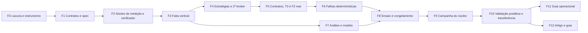

# 08 — Roadmap

Tamanho relativo: **P**, **M**, **G**. A ordem mudou em relação ao plano inicial: contribuição,
contratos e verificador vêm **antes** de qualquer campanha.

## F0 — Lacuna e decisão do instrumento (M) — **bloqueante**
- [ ] Revisão sistemática leve conforme doc 11 §2; matriz preenchida
- [ ] Declaração de lacuna escrita (doc 11 §5.3)
- [ ] *Spike* de 3 dias no OpenMessaging Benchmark; tabela §6.1 preenchida com evidência
- [ ] ADR do instrumento (estender × construir)
- [ ] Docker no WSL, esqueleto Gradle/uv, CI, `versions.env`

**Aceite:** lacuna demonstrada (ou pergunta central revista) **e** ADR do instrumento registrada.
Sem isso, F2 não começa.

## F1 — Contratos, modelo formal e histórias mínimas (M)
- [ ] Contratos K/E/O/S escritos como asserções executáveis (doc 12)
- [ ] Modelo formal em `spec/` com as três propriedades do doc 12 §13
- [ ] Contraexemplo do fencing gerado pelo modelo → história H-A
- [ ] Histórias H-A…H-J implementadas como testes determinísticos (podem usar `inmemory`/`chaos`)

**Aceite:** todas as histórias rodando na CI, com classificação esperada exata.

## F2 — Núcleo de medição e verificador (G)
- [ ] Envelope com `aggregateId`/`aggregateVersion`; gerador com concorrência por agregado
- [ ] População por `t_int`, censura, histogramas por fase do evento
- [ ] `W(t)`, prova de quiescência, categorias incluindo `indeterminado`
- [ ] Multiplicidade **por grupo**; ordem por grupo com banda de relógio
- [ ] Observador durável (checkpoint + `fsync`)
- [ ] `FaultInjector` e relatório de cobertura
- [ ] `studyctl`: matriz, blocos, retomada, precisão-alvo, selagem

**Aceite:** calibração N02 completa; `chaos` reproduz contagens exatas; H-I produz `indeterminado`;
teste de CO visível na cauda.

## F3 — Fatia vertical: PostgreSQL + Kafka + `outbox-poll` (M)
- [ ] Adapter Kafka com `FencedPublisher` e `ContractAsserter`
- [ ] Operação de negócio `tx-realistic`, outbox, relay `partition-lease` com fencing
- [ ] Coleta de recursos e pipeline de análise mínimo
- [ ] N01 e um N04 reduzido, localmente

**Aceite:** uma curva de fronteira gerada só por comando, a partir de dados brutos, com contrato
asserido e integridade verificada.

## F4 — Estratégias restantes e segundo broker (G)
- [ ] `outbox-notify`; CDC via Kafka Connect e via Debezium Server
- [ ] RabbitMQ quorum (sem cercamento → caminho de O1 sob F7 documentado)
- [ ] Controles: `tx-only`, `dw-after`, `dw-before`, `pg-queue`

**Aceite:** N01 verde para todas as estratégias; ablação A4 (2×2) executável.

## F5 — Contratos, topologias e F2 real (M)
- [ ] T3 dos dois brokers; PostgreSQL com standby síncrono
- [ ] Asserção de contrato efetivo em toda execução
- [ ] `dm-log-writes`/reset de VM operando; procedimento versionado
- [ ] Mídia de disco como fator (NVMe × rede)

**Aceite:** H-E (K1 × K2) reproduzida no ambiente dedicado com perda observada em K1 e zero em K2.

## F6 — Falhas determinísticas e cobertura (M)
- [ ] Timeline com fault points; `coverage.json`
- [ ] N14 completo; H-A, H-B, H-J em campanha
- [ ] Métricas de resiliência e linguagem de cobertura na análise

**Aceite:** cada contrato alegado tem cobertura ≥ 1 por classe de falha exigida (doc 12 §10).

## F7 — Análise, modelo mecanístico e previsões (M)
- [ ] Pipeline completo com classificação estatística única (doc 05 §7)
- [ ] Microexperimentos das constantes do modelo (doc 13 §5.2)
- [ ] Ajuste com o conjunto de ajuste; previsões geradas para as configurações seladas

**Aceite:** `analysis/predictions/<campanha>.json` gerado e com hash no commit, **antes** de N17.

## F8 — Ensaio e congelamento do protocolo (M)
- [ ] Campanha exploratória (1 repetição, janelas curtas)
- [ ] Revisão externa de adapters, configs e contratos
- [ ] Selagem das configurações de validação; tag `protocol-v1`

**Aceite:** protocolo congelado com previsões registradas e configurações seladas intocadas.

## F9 — Campanha do núcleo (G — tempo de máquina)
- [ ] N03–N16 com repetições guiadas por precisão
- [ ] Anomalias investigadas; inválidas documentadas

**Aceite:** todos os resultados primários com precisão-alvo atingida ou marcados `inconclusivo`.

## F10 — Validação preditiva e transferência (M)
- [ ] N17 (seladas) e N18 (outra mídia, outro ambiente, carga representativa × controle)
- [ ] Erro de previsão reportado conforme doc 13 §5.3

**Aceite:** erro publicado, seja confirmação ou refutação do modelo.

## F11 — Guia operacional (G)
- [ ] Sistemas P1 nos cenários G, com o mesmo método
- [ ] Capítulos do guia gerados; casos próximos sinalizados

**Aceite:** `studyctl guide --strict` sem pendências.

## F12 — Artigo e guia finais (M)
- [ ] Artigo do núcleo: lacuna, contratos, resultados, previsões, limitações, cobertura
- [ ] Guia publicado; tags `article-v1` e `guide-v1`

## Definição de Pronto de um adapter
Publisher/consumer/provisioner assíncronos · `ContractAsserter` implementado · capacidades e
contratos declarados e verificados · conformidade e histórias aplicáveis verdes · Compose T1/T3 ·
configs `default`/`tuned` justificadas · exporter e dashboard · N01 aprovado · entrada no diário ·
revisão por outra pessoa.
